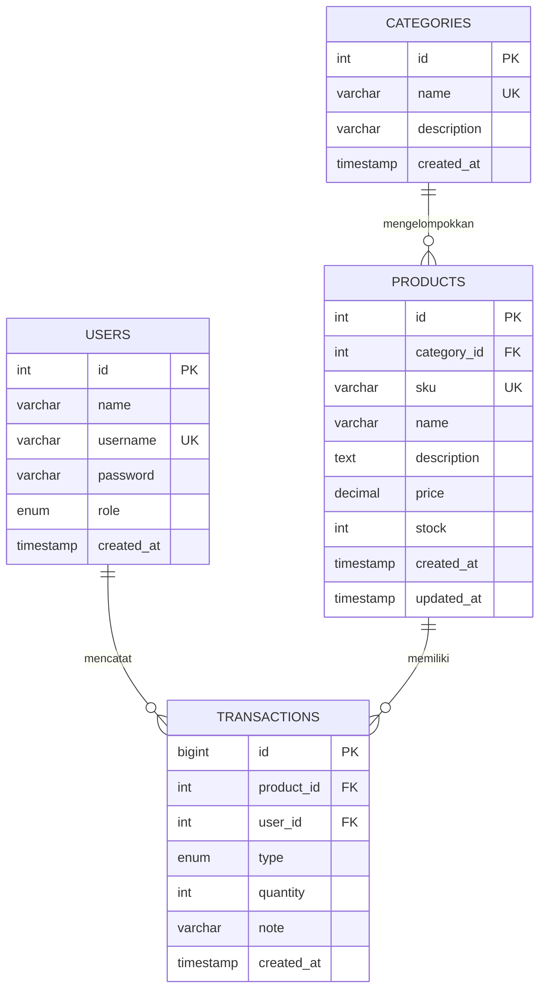

# ERD — Inventaris Barang

## Penjelasan relasi
- Satu kategori dapat memiliki banyak produk. Satu produk hanya terhubung ke satu kategori.
- Satu produk dapat memiliki banyak catatan transaksi.
- Satu user dapat mencatat banyak transaksi.
- Foreign key menggunakan `RESTRICT` saat penghapusan untuk melindungi data yang masih dipakai.
